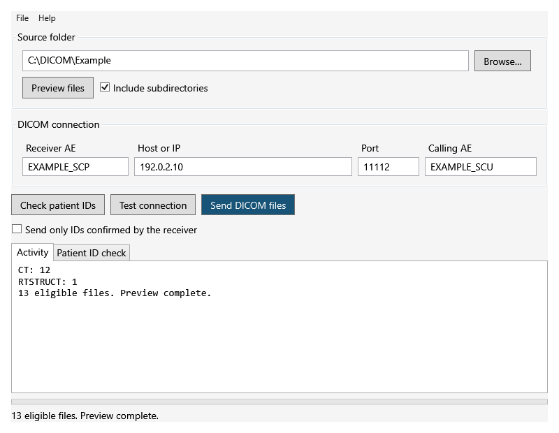

# AKKI · DICOM batch importer for ARIA

Send DICOM files from a folder to a configured storage receiver on Windows. Preview the batch by modality, test the connection and check what the receiver reported for each transfer. AKKI runs independently of Eclipse and was originally written for a research project using Eclipse 15.1.

[Download the Windows build](https://github.com/Kiragroh/Akki_Custom-Varian-Importer/releases/tag/v1.2.0) · [Historical receiver setup notes](Akki_ARIA_Importer_MG/Manual_Adding%20of%20requiered%20DicomDaemon.pdf)



## Run a batch

1. Extract the release ZIP on Windows with .NET Framework 4.8 installed. Keep its contents together and start `Akki_ARIA_Importer_MG.exe`. The older executable in the repository is a historical snapshot.
2. Choose **Browse…**, select a dedicated folder and check **Include subdirectories**. **Preview files** counts eligible objects by modality without sending them. It excludes filenames containing the case-sensitive text `_ignore` and files without a readable, nonblank Modality. The preview shows counts only. AKKI transmits the original objects with their identifiers.
3. Enter the **Receiver AE**, **Host or IP**, **Port** and **Calling AE** supplied by your DICOM administrator. Use **Test connection** to issue a C-ECHO. Settings are saved for the Windows user when the window closes. The distributed configuration contains examples.
4. **Send DICOM files** rescans the selected folder and performs a C-ECHO before the first C-STORE. Progress advances per object. The summary counts success (`0000`), warning (`Bxxx`), failure and missing replies separately. After an interruption, check the receiver before retrying because it may already have accepted part of the batch.

## Check patient IDs before sending

**Check patient IDs** reads incoming Patient ID (0010,0020) and Issuer of Patient ID (0010,0021) and performs a DICOM Patient Root C-FIND at the configured receiver for each distinct, queryable ID/issuer pair. The table shows the original ID (including leading zeros), issuer and file count. This action sends lookup keys only. Patient IDs appear in the on-screen table and are omitted from the activity log.

| Receiver result | How to interpret it |
| --- | --- |
| Exact match | One result matches both the incoming ID and the issuer as returned by the query service. |
| No visible match | The query completed successfully with zero results. For a genuinely new patient, the incoming ID is the creation candidate **if the daemon preserves source IDs**. With creation disabled, expect the daemon to reject or withhold the import. |
| Unconfirmed | The query failed, is unsupported, returned ambiguous or differing identifiers, or the source ID cannot safely be queried. |

C-FIND reports the receiver's visible query index. Patients without indexed studies, query permissions and ID mapping rules can affect the prediction. AKKI cannot read the daemon's creation policy or predict a generated or remapped ID. Verify that the queried AE reflects the destination database.

Select **Send only IDs confirmed by the receiver** to enforce a local filter. During that transfer AKKI checks the IDs again, once per distinct pair, and skips all unconfirmed or unmatched files. Clearing the checkbox leaves new-patient handling to the daemon. No patient record is created by the check.

## Eclipse / ARIA 18

AKKI uses DICOM C-ECHO and C-STORE through fo-dicom. It requires no ESAPI assembly, Eclipse plug-in registration or open patient. For an Eclipse 18 installation, configure the DICOM receiver for the calling AE and the storage classes and transfer syntaxes used by your files.

A site connection check verified C-ECHO and negotiation of CT Image, RT Structure Set, RT Plan and RT Dose Storage. Synthetic C-STORE transfers were tested against a local receiver. To verify the full workflow on a new installation, send an approved test case to its test receiver and check the resulting objects and references in ARIA.

**RT dependencies.** AKKI sends files in directory enumeration order. If the receiver requires CT → RTSTRUCT → RTPLAN → RTDOSE, use one folder per stage and verify each stage at the receiver.

## Build and test

Use Windows, Visual Studio or Build Tools with the .NET desktop workload, and the .NET Framework 4.8 targeting pack. In a Developer PowerShell at the repository root:

```powershell
$sln = 'Akki_ARIA_Importer_MG/SourceCode/Akki_ARIA_Importer_MG/Akki_ARIA_Importer_MG.sln'
msbuild $sln -restore -p:RestorePackagesConfig=true -p:Configuration=Release '-p:Platform=Any CPU'
$exe = Join-Path (Split-Path $sln) 'Akki_ARIA_Importer_MG/bin/Release/Akki_ARIA_Importer_MG.exe'
python -m pip install 'pydicom>=2.4,<3' 'pynetdicom>=2.1,<3'
python tests/test_loopback.py $exe
```

The test invokes the compiled WPF preview, patient check and import controls, including the confirmed-only filter. A loopback receiver returns success, warning and failure for synthetic objects. No site configuration is needed.

This independent research tool is provided without warranty or vendor support. Validate the receiving workflow in an isolated test environment before clinical use.
